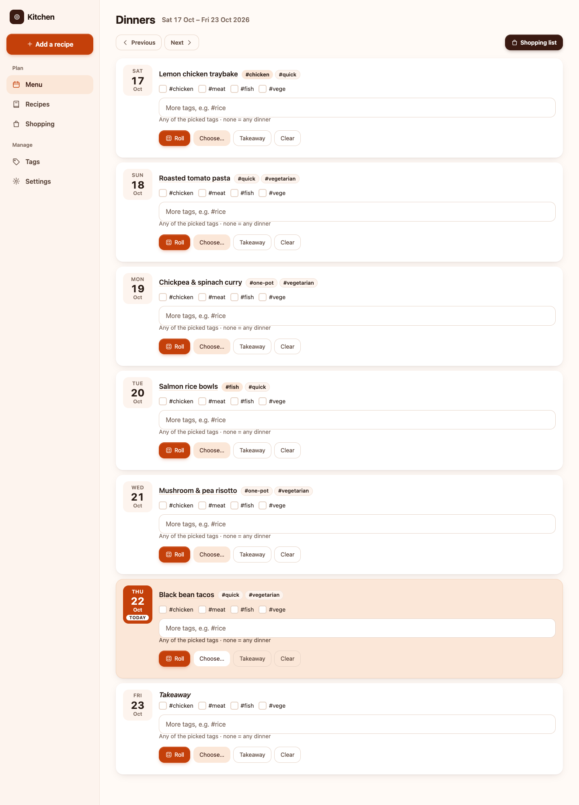
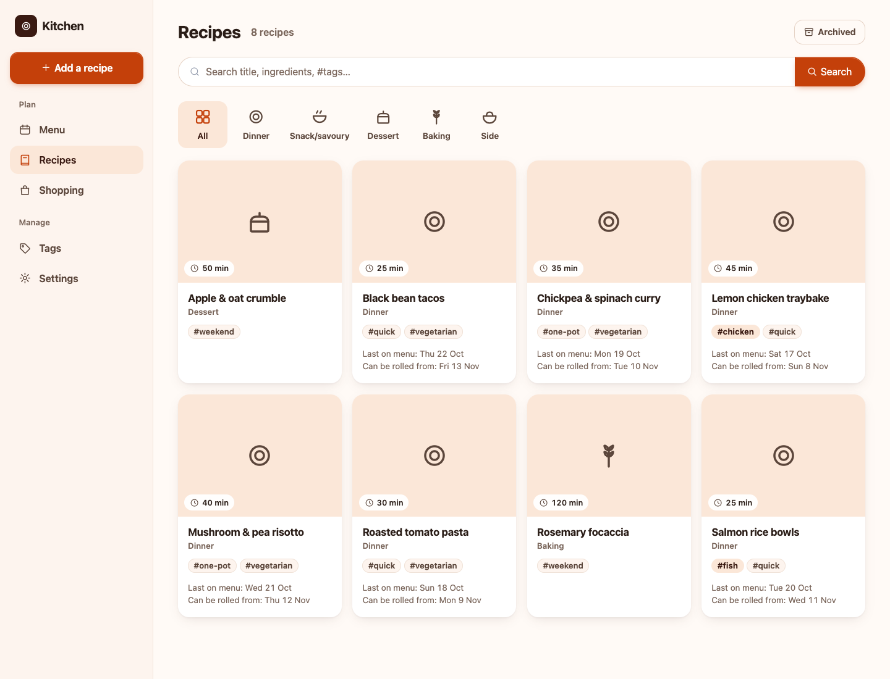
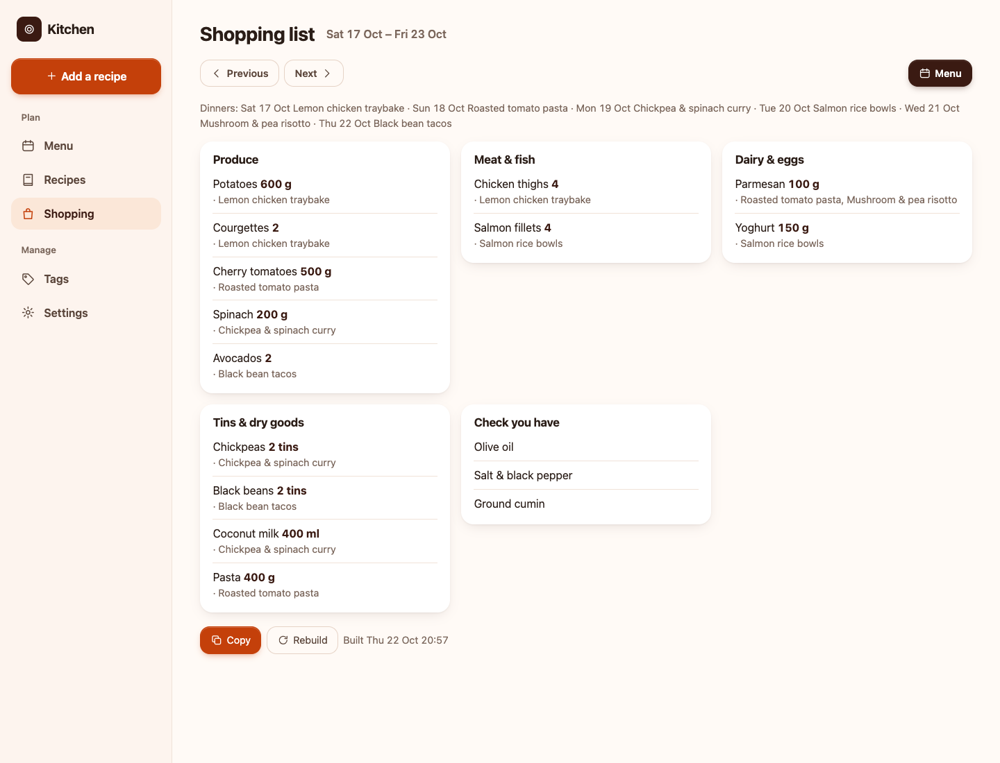
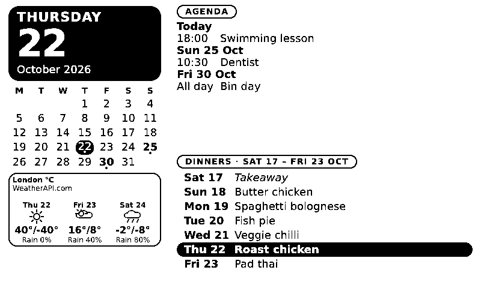
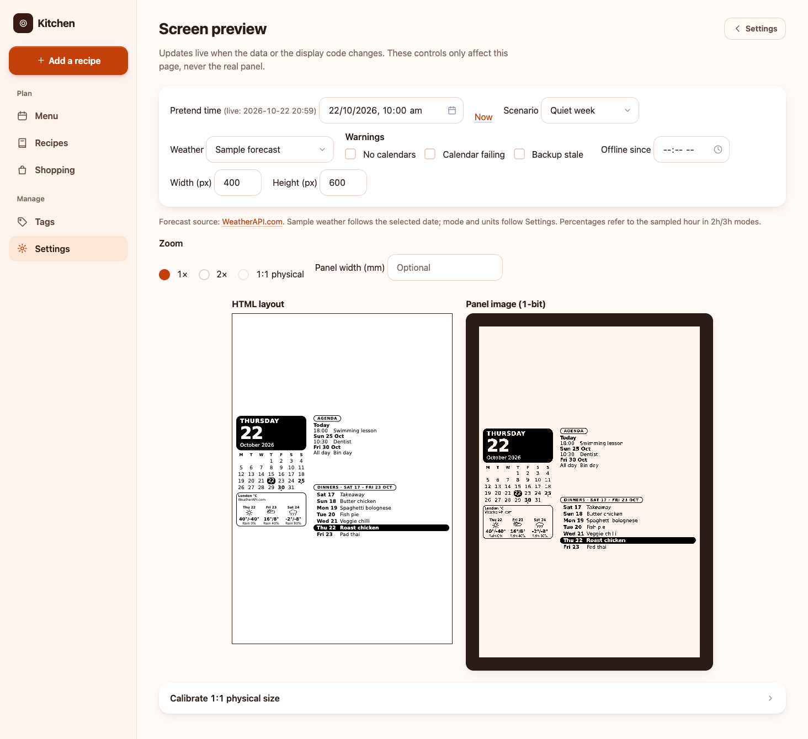

# home-calendar-screen

A self-hosted kitchen planner with recipes, a weekly dinner menu, shopping lists and a calendar screen. Use it in a browser, or send its black-and-white image to an e-ink display.

- Save recipes by hand, or use Claude to import links, pasted text, screenshots and handwritten pages.
- Plan dinners from Saturday to Friday. Pick a recipe, filter suggestions by tags, roll the dice, or mark a takeaway.
- Generate a shopping list from the week's dinners, grouped by aisle, with pantry staples separated out.
- Show calendar events, dinners and optional weather and UK bin collections on a monochrome screen.
- Preview the screen without hardware. Request different image sizes; other panels need their own hardware adapter.

**There is no login or access control. Anyone who can reach the app can view and change household data. Keep it on a private home network, VPN or tailnet. Do not expose port 8000 to the public internet.** HTTPS alone does not make it private. Protect the data, backups, calendar URLs and API keys too.

The server uses Python, FastAPI and SQLite. The optional display client polls it every five minutes. Only the Raspberry Pi + Waveshare 7.5-inch V2 adapter is bundled; changing image dimensions does not add a driver for another panel.

**Jump to:** [Screenshots](#a-look-around) · [Docker setup](#start-with-docker) · [First use](#first-use) · [Configuration](#server-configuration) · [Display client](#display-client) · [Backups and updates](#backups-updates-and-recovery) · [Development](#local-development) · [Troubleshooting](#common-problems)

## A look around

These are real app screens populated with sample household data, not personal calendars. The display examples use a fixed preview date and sample weather.

### Weekly menu

Choose dinners for the week, with tag filters and dice suggestions available on each day.



### Recipe library

Browse saved recipes and filter by category, tag or search text. Recipes can be entered manually or filled from an import.



### Shopping list

Generated ingredients are grouped by aisle. Rebuild after changes, compare with the previous list, or copy the text to another app.



### Calendar display

The default 800×480 composition combines the month, upcoming events, dinners and optional weather.



### Screen preview

The preview shows HTML and the final monochrome PNG. This portrait example fits the same composition with white space above and below.



## Start with Docker

You need Docker with Compose and a host that can run the selected image. The release workflow currently publishes **Linux ARM64** images. For another architecture, build from source as shown below.

**Version note:** [`deploy/compose.yaml`](deploy/compose.yaml) currently pins `v0.3.0`. That release may predate the portable image sizes and adapter interface described in this README. Do not assume that pulling the pinned image gives you every feature in the current source. Select a release that includes the features you need, or build this checkout locally.

From a clone of this repository:

```sh
mkdir -p ~/home-calendar
cp deploy/compose.yaml ~/home-calendar/compose.yaml
cd ~/home-calendar
```

Create a file named `.env` beside `compose.yaml`:

```dotenv
TZ=Europe/London
ANTHROPIC_API_KEY=
# Optional: enable AI imports, tag suggestions and shopping-list generation.
# ANTHROPIC_API_KEY=your-key
# Optional: allow weather setup in Settings.
# WEATHER_API_KEY=your-weatherapi-key
```

An [Anthropic API key](https://console.anthropic.com/) is **optional**. Manual recipes, manual tags, menu choices, dice suggestions, calendar feeds and display rendering do not require it. Recipe extraction, automatic tag suggestions and shopping-list generation do. With a key configured, saving a manually entered recipe can also trigger background tag suggestions. AI requests send relevant recipe content, images or shopping ingredients to Anthropic and can incur charges. Check generated recipes and quantities yourself.

Create writable storage and start the server. The container runs as user 1000, group 100:

```sh
mkdir -p data backups
sudo chown 1000:100 data backups
docker compose up -d
```

Open `http://<server>:8000`. The home page opens the weekly menu. Check basic server health with:

```sh
curl http://localhost:8000/healthz
# {"ok":true}
```

Database migrations run automatically when the container starts. `/healthz` checks that the web server responds; it does not prove that imports, calendar providers or physical hardware work.

To run the current checkout instead of a published image, build from the repository root:

```sh
docker build -t home-calendar:local server
```

Then change `image:` in your copied Compose file to `home-calendar:local` and run `docker compose up -d`. The local image uses the host's build architecture by default. Keep the data and backup mounts.

## First use

### 1. Connect calendars in Settings

Open **Settings → Calendars**. Give each feed a name and paste its ICS/iCal URL. For Google Calendar, use **Settings → your calendar → Integrate calendar → Secret address in iCal format**. The app reads feeds; it does not edit your calendar.

Treat a secret ICS URL like a password: it grants access to calendar data. Do not paste real feeds into issues, screenshots or repository files. Feeds are saved in the database, so protect backups as well.

The app syncs on startup and every 15 minutes. **Sync now** requests an immediate refresh, but Google can take hours to update its published feed. Failed refreshes keep the last successful events and show status in Settings.

### 2. Add recipes

Open **Recipes → Add a recipe** (`/dishes/new`). Enter a title, ingredients, steps and any useful tags yourself. No API key is needed for that path; leave the import source fields empty for a fully manual recipe.

With an Anthropic key, add a recipe link, paste source text or upload screenshots to fill missing details in the background. Handwritten pages have a separate batch import and review flow. Check the result and edit mistakes before cooking. Some social sites block automated downloads; paste the caption or upload screenshots instead.

Search the library and filter by recipe category or tag. Archive recipes you no longer want in normal browsing and suggestions.

### 3. Plan the week

Open **Menu** (`/menu`). Weeks run **Saturday–Friday**. Pick a saved recipe for a day, choose takeaway, or clear the selection. The dice suggests dinners from your library, not AI-generated meals. Tags narrow the suggestions; the dice avoids recipes scheduled within 21 days of that date. You can still pick a recipe manually when it warns about a repeat.

### 4. Build the shopping list

Open **Shopping** for the intended week; its default is next week. Add dinners first, then choose **Build list**. This step needs the Anthropic key. The list combines ingredients, groups them into aisles and puts items from **Settings → Pantry staples** under **Check you have**.

Saved lists for this week and next rebuild automatically after menu/recipe changes settle for about five minutes. Pantry changes can mark a list out of date; use **Rebuild**. The page shows changes since the previous list.

There is **no in-app shopping-item editor or tick-off checklist**. To correct source quantities, edit the recipe, menu or pantry and rebuild. For extra items or manual changes to the finished list, use **Copy** and edit it in your notes/shopping app. Copying needs browser clipboard permission and normally HTTPS or localhost.

### 5. Set up the screen and optional extras

- **Screen preview** in Settings (`/preview`) works without a panel. Compare the HTML composition with the final 1-bit PNG, try sample scenarios, and change output dimensions. Preview controls do not change another screen's settings.
- **Settings → Display** controls the night pause, initially **23:00–06:00** in the server's `TZ`. The last image remains visible; the panel is not blanked and its host stays on. Maintenance refreshes can override the pause for hardware safety.
- **Weather:** set a [WeatherAPI.com](https://www.weatherapi.com/) key in the server environment, recreate the container, then search for and select a location in Settings. Enable weather separately. Choose daily or sampled-hour forecasts and Celsius/Fahrenheit. The forecast uses the location's timezone; calendar/menu dates use `TZ`.
- **Bins:** enter a UK postcode and house number/name in Settings. The app uses [postcodes.io](https://postcodes.io/) to find the council and asks for a UPRN if required. If needed, choose a supported council yourself. Dates come from [UKBinCollectionData](https://github.com/robbrad/UKBinCollectionData); not every council is supported, and browser-dependent scrapers are excluded. No API key is needed. Returned collections appear as all-day agenda events and month dots; dates are not extrapolated.

Weather refreshes every 30 minutes; last-good forecasts become stale after one hour and disappear after six hours or outside forecast coverage. Bins refresh twice daily, retry hourly after failures and show a warning after two days of failures. **Update now** refreshes bins manually; **Remove** clears the saved address and dates. Keep real household addresses out of repository files.

## Server configuration

Set these in the server process environment. With the supplied Compose file, put the API keys, model and timezone in `.env`, then run `docker compose up -d` to recreate the container.

| Variable | Default | Purpose |
| --- | --- | --- |
| `TZ` | `Europe/London` | Calendar/menu dates, backup time and display night-pause timezone. |
| `ANTHROPIC_API_KEY` | Unset | Optional AI recipe import, tag suggestions and shopping lists. |
| `LLM_MODEL` | `claude-sonnet-5-5` | Claude model used for AI features; overrides must support structured outputs. |
| `WEATHER_API_KEY` | Unset | Optional WeatherAPI.com access; weather still needs enabling in Settings. |
| `DATA_DIR` | `/data` | SQLite `app.db` and uploaded/downloaded `media/`. |
| `BACKUP_DIR` | `/backups` | Existing directory for database snapshots and the media mirror. |

The Compose mounts map `./data` and `./backups` to those container paths. It does not forward `DATA_DIR`/`BACKUP_DIR` from `.env`; change the Compose environment and mounts together if you need different container paths. Calendars, pantry, weather location, bins and night-pause settings live in SQLite, not environment variables.

A private reverse proxy can provide HTTPS. Keep access restricted to trusted users and only forward traffic from a trusted proxy: the container enables proxy headers. For a private certificate authority, install its root certificate on browsers/phones and configure the display client's `CA_FILE`; do not disable certificate verification.

## Display client

You do not need a physical screen to use the planner or preview. The server creates a monochrome PNG; a client and adapter handle getting it onto hardware.

### Raspberry Pi + Waveshare 7.5-inch V2

Use Raspberry Pi OS Lite 64-bit and the matching HAT/panel. Wire the hardware according to its manufacturer's instructions.

Copy the **complete** client directory to the Pi, dereferencing symlinks. From a full repository checkout on your computer:

```sh
rsync -rL display-client/ pi@your-pi:~/home-calendar-frame/
```

`display-client/stamp.py` links to a shared server file in the repository. `-L` makes it a real file on the Pi; copying only `frame.py` is not enough.

On the Pi, as a normal user with sudo:

```sh
cd ~/home-calendar-frame
sudo ./install.sh
# Optional timezone override instead:
# sudo TIMEZONE=Europe/Paris ./install.sh
```

The installer enables SPI, installs Pillow/fonts/GPIO packages, downloads pinned Waveshare files, copies the client and adapters to `/opt/home-calendar-frame`, and enables **and starts** a five-minute systemd timer. It preserves an existing `/etc/home-calendar-frame/frame.env`.

Edit that file and set `FRAME_URL=http://your-server:8000/display/frame.png`. For HTTPS with a private CA, set `CA_FILE` to the CA root file's path; otherwise leave it empty. Reboot for SPI/group changes, then check a run:

```sh
sudo systemctl start home-calendar-frame.service
journalctl -u home-calendar-frame -n 20
```

### Generic Linux installation

For another adapter on an apt-based Linux host with systemd, copy the same complete directory and run:

```sh
sudo ./install.sh --generic
```

This installs `python3-pil`, `fonts-dejavu-core`, the client/adapters and service/timer. It skips Raspberry Pi SPI/GPIO configuration, GPIO libraries/groups and vendor downloads. It enables the timer **without starting it**.

Install your own trusted local adapter and its hardware dependencies, configure its pins/transport, then set `FRAME_DRIVER=your_module:create` and `FRAME_URL` in `/etc/home-calendar-frame/frame.env`. Start polling only after that setup:

```sh
sudo systemctl start home-calendar-frame.timer
```

No other panels' adapters are supplied or claimed to work automatically. The installer accepts only no arguments or `--generic`.

### Try the client without hardware

Direct use needs Python, Pillow and a POSIX host with `fcntl.flock`; it does not need systemd. Windows is not supported by this client. With the development environment below installed, run from the repository root:

```sh
server/.venv/bin/python display-client/frame.py \
  --url http://127.0.0.1:8000/display/frame.png \
  --width 600 --height 800 \
  --state-dir /tmp/hcs-portrait-demo \
  --dry-run --out /tmp/hcs-portrait.png
```

Dry-run never loads a hardware driver. It still obeys night pause and redraw history: disable the pause in the isolated server's Settings if needed, and use a separate state directory from any physical screen. Running the command once fetches/checks once; the installed timer provides recurring polling. Default dry-run dimensions are 800×480.

<details>
<summary>Image geometry, preview calibration and HTTP reference</summary>

### Output sizes

`/display/frame.png?width=600&height=800` returns a 600×800 mode-`1` PNG. `/display`, `/preview`, `/preview/version` and `/preview/frame.png` accept the same dimension parameters. Each axis defaults independently: `?width=400` means 400×480, not 400×240.

Each dimension must be an integer from 1 to 8192; total pixels cannot exceed 16,777,216. Empty, malformed, repeated and out-of-range dimensions return HTTP 422. These limits prevent excessive image allocation, not unreadable text on very small screens.

The layout remains an 800×480 design canvas. It fits inside the requested image, centred on white, without cropping or deliberate stretching. Nearest-neighbour resizing keeps the output monochrome. Examples:

| Output | Fitted content | White margins |
| --- | --- | --- |
| 400×240 | 400×240 | None |
| 600×800 | 600×360 | 220 pixels above and below |
| 1200×825 | 1200×720 | 52 pixels above, 53 below |

Integer rounding can produce a subpixel difference between the HTML scale axes. Portrait is simply height greater than width; mounting rotation is the adapter's responsibility. Offline stamps use the same fitted coordinates and do not fill the letterbox bars.

Sizes are request-local, so different screens can share a server. The server renders a canonical composition, caches fitted representations, and uses representation-specific ETags for conditional requests. `X-Display-Policy` carries the shared night-pause policy, including on 304 responses and render failures; a fresh client needs a valid policy before a normal draw.

### Preview controls

`/preview` offers pretend time, scenarios, warnings, offline stamp, weather states and dimensions without changing the live display. The optional offline stamp appears only in the PNG pane. The preview refreshes as data changes; local development with `--reload` also picks up code changes.

1×/2× zoom uses the selected pixel dimensions. Physical-size zoom needs the panel's physical width in millimetres: 163.2 mm is the default only at 800×480. Other sizes require a positive width before that mode is enabled. Panel width is saved in this browser per resolution; the bank-card calibration is shared across resolutions in that browser. Neither affects server settings or image cache identity.

</details>

<details>
<summary>Adapter contract, client options and refresh safety</summary>

### Options

| CLI option | Environment/default | Meaning |
| --- | --- | --- |
| `--url` | `FRAME_URL`, required | Server frame PNG URL. |
| `--driver` | `FRAME_DRIVER=adapters.waveshare7in5_v2:create` | Trusted local Python `module:factory`; not loaded in dry-run. |
| `--width`, `--height` | `FRAME_WIDTH`, `FRAME_HEIGHT` | Real mode: must match adapter size. Dry-run: independently default to 800 and 480. |
| `--ca-file` | `CA_FILE`, unset | Root CA bundle for HTTPS. |
| `--state-dir` | `/var/lib/home-calendar-frame` | Persistent state for one physical screen. |
| `--dry-run` | Off | Save an image instead of driving hardware. |
| `--out` | Required with `--dry-run` | Output PNG path. |

The client adds resolved dimensions to the URL and preserves other parameters. Matching existing dimensions are accepted and emitted once. Mismatching or repeated width/height parameters are errors.

### Writing an adapter

The factory takes no arguments and returns an object with `.spec` (a `PanelSpec` from `display-client/adapters`) and callable `.show(image)`. Adapter code is trusted, locally installed Python, never a remote download chosen by the server. Spec loading must not initialize GPIO or import hardware dependencies.

`show` receives a clean or offline-stamped mode-`1` Pillow image exactly matching `spec.size`. The adapter owns transport, pixel packing, mounting rotation, hardware dependencies and sleep/cleanup. The bundled implementation imports Waveshare lazily and sleeps in `finally`, including after draw failures.

`PanelSpec(size, min_interval, maintenance_after, max_interval)` is frozen. Size is a tuple of two integers (not booleans), with the server's dimension/pixel bounds. Timing values are `datetime.timedelta`; minimum spacing is nonnegative. Both maintenance values may be `None` to disable periodic/pre-pause maintenance. Otherwise require `min_interval <= maintenance_after < max_interval`, with at least five minutes between maintenance and maximum intervals. Invalid drivers/specs fail before networking or drawing. The fixed five-minute poll cadence cannot serve panels requiring more frequent maintenance.

### State and safety

The bundled Waveshare adapter spaces **all** redraws at least 180 seconds apart, including offline/recovery redraws. It forces a normal full redraw after 23 hours 45 minutes, leaving margin before 24 hours. Maintenance can use a compatible cached image when offline, override night pause, or happen just before a pause would exceed that maximum. It does not add an extra blank/`Clear()` cycle. Other adapters use their own timing spec; dry-run uses the bundled timings.

After an hour of connection failures, the next permitted redraw adds **Offline since HH:MM**. Maintenance keeps the original warning time; recovery removes the warning only when a clean frame is actually drawn. Polling continues during night pause so changed settings can arrive.

The state directory stores the clean last-good image, ETag, policy, failure state and attempt/completion timestamps. A lock serializes concurrent runs. Attempts are persisted before hardware access and completions after successful drawing. **Use a different state directory for each physical screen**, including when changing adapters to drive another device. Do not delete history to force a redraw or bypass spacing guards.

Unreadable or wrong-size cached images are unavailable for stamping/maintenance. The client fetches a replacement without their ETag but preserves refresh history. Wrong-size/unreadable fetched images keep last-good state and return exit code 2. A fresh client without a valid server policy does not perform a normal draw. Corrupt persisted state stops the run rather than attempting an untracked refresh.

When upgrading, copy `frame.py`, the shared stamp and `adapters/` together and rerun the appropriate installer. Existing Waveshare users need no driver/dimension changes. Remove old `QUIET_HOURS` settings or `--quiet-hours` arguments: Settings is now the schedule authority. Old cache metadata migrates automatically; a cache without refresh history waits a full three-minute guard before its first safety redraw.

The client is a POSIX Python program, not microcontroller firmware. A microcontroller/network display can consume the PNG endpoint through its own client, but no such firmware is provided here.

</details>

## Backups, updates and recovery

**Settings → Backup → Back up now** runs a backup and shows the latest status. Scheduled backups run at **03:30 in `TZ`** while the server is running. `BACKUP_DIR` must already exist and be writable; the app reports an error rather than creating a missing backup root.

With the supplied Compose mounts:

```text
backups/
  YYYY-MM-DD/app.db   # dated SQLite snapshot
  media/             # one shared copy of media, not a per-date snapshot
```

Database snapshots use SQLite's backup API. Dated directories at least 14 days old are removed. Media files are copied when new/changed; deleted source files are not removed from the mirror. This is not a versioned media archive, and it does not back up `.env`, Compose configuration or display-client state. Keep separate protected copies of those and copy backups off the host.

Before updating, use **Back up now**, check it succeeded, and preserve the old configuration/image version. Change the Compose image tag to the chosen release, then:

```sh
docker compose pull
docker compose up -d
docker compose logs --tail=100 home-calendar
```

For a locally built image, rebuild it instead of pulling. Migrations run on container startup. Do not assume an older image can read a database migrated by a newer release.

There is no one-click restore. A manual recovery procedure is:

1. Stop the server (`docker compose stop`) so it cannot write during recovery.
2. Preserve the entire current `data/` directory elsewhere before changing anything, including any SQLite `-wal`/`-shm` files.
3. In a clean replacement data directory, put the selected dated `app.db` at `data/app.db` and copy `backups/media/` to `data/media/`. Do not mix old SQLite sidecar files with the restored database. The shared media mirror is not an exact snapshot of that date.
4. Restore ownership (`1000:100` for the supplied image), point Compose at the replacement directory, and start a compatible server version. Check logs, Settings and a few recipes/calendar entries.

This describes the stored backup layout and a recovery approach, not a guarantee that your backups are usable. Test recovery on a separate private instance before relying on it.

## Local development

Use **Python 3.12**. Native setup needs FFmpeg for video/audio import and DejaVu fonts for rendering. Install those with your OS package manager. On Linux, Playwright may also need system libraries (`playwright install --with-deps chromium`). The Dockerfile includes these system dependencies.

From the repository root:

```sh
cd server
python3.12 -m venv .venv
.venv/bin/pip install -r requirements-dev.txt
.venv/bin/playwright install chromium

mkdir -p /tmp/hcs-dev-data /tmp/hcs-dev-backups
export DATA_DIR=/tmp/hcs-dev-data
export BACKUP_DIR=/tmp/hcs-dev-backups
export TZ=Europe/London
# Optional: export ANTHROPIC_API_KEY=your-key
# Optional: export WEATHER_API_KEY=your-key
.venv/bin/alembic upgrade head
.venv/bin/uvicorn app.main:app --reload
```

Open `http://127.0.0.1:8000`. Keep port **8000**: the server's internal Chromium render URL is fixed to `http://127.0.0.1:8000`. Use one server worker, as in the container entrypoint. Keep development storage separate from real household data.

Run the test suites when changing code:

```sh
# From server/
.venv/bin/python -m pytest -q

# From the repository root
server/.venv/bin/python -m pytest -q display-client
```

### Repository map for contributors and coding agents

| Path | Start here for |
| --- | --- |
| `server/app/main.py` | App setup, routes and background loops. |
| `server/app/config.py`, `db.py`, `models.py` | Environment settings, SQLite sessions and database models. |
| `server/app/dishes/`, `tags/`, `ingest/` | Recipe editing/search, tags and queued AI import/review. |
| `server/app/menu/`, `shopping/` | Weekly planning, dice logic and shopping generation/rebuilds. |
| `server/app/calendars/`, `weather/`, `bins/` | External feeds/providers and last-good caches. |
| `server/app/display/` | Screen data, geometry, PNG rendering, policy and preview. |
| `server/app/templates/`, `static/` | Jinja templates, HTMX/browser UI and CSS. |
| `server/app/backup.py` | Backup format, scheduling and retention. |
| `server/migrations/`, `server/tests/` | Alembic schema changes and server regression tests. |
| `display-client/` | Standalone fetch/state lifecycle, adapters, installer and client tests. |
| `deploy/compose.yaml`, `server/Dockerfile` | Deployment defaults and image build. |
| `DESIGN.md`, `PRODUCT.md` | Design/product context; confirm current behavior in code. |

`display-client/stamp.py` is a symlink to `server/app/display/stamp.py`. Keep that shared code standalone (stdlib/Pillow only) and preserve the symlink in source. Display geometry is request-local; refresh state belongs to a physical screen. Do not use real calendar secrets, addresses or API keys in fixtures or screenshots.

## Common problems

| Problem | What to check |
| --- | --- |
| Container cannot write the database or backup | Check the `data/` and `backups/` mounts and ownership (`1000:100`). Look at `docker compose logs --tail=100 home-calendar`. |
| AI import/list fails | Confirm a nonempty API key, account access/credits and a model supporting structured outputs. Restart/recreate after environment changes. Manual recipes/menu still work without AI. |
| A recipe link cannot be read | The site may block downloads. Paste the recipe/caption or upload screenshots and retry. |
| Calendar looks old | Check Settings status and **Sync now**. The provider's ICS feed may lag; failed syncs retain old events. |
| Preview or frame render fails locally | Install Playwright Chromium and its system libraries, check DejaVu fonts, and run on port 8000. Check server logs. |
| A custom image size returns 422 | Use one integer `width`/`height` each, 1–8192, within the total pixel limit. Ensure the running server release includes portable output. |
| Dry-run produces no new file or panel does not redraw | Check night pause, refresh spacing/history, valid policy from the server and frame URL. Do not erase a physical screen's state to force it. |
| Client rejects size or driver | Real-mode dimensions must match the adapter. Install the local module/dependencies and copy `adapters/` plus `stamp.py`, not just `frame.py`. |
| HTTPS fails on the client | Supply the correct private root CA via `CA_FILE`; check hostname and certificate validity. Do not bypass TLS checks. |
| Weather is missing | Add `WEATHER_API_KEY`, recreate the server, select a location **and enable weather**. Expired/out-of-range cached forecasts are hidden. |
| Shopping Copy fails | Allow clipboard access and use HTTPS or localhost; alternatively select/copy the visible text. |

## Release and license

The release workflow runs server and display-client tests for pushed `vX.Y.Z` tags, then publishes `ghcr.io/mustyf10/home-calendar-screen:vX.Y.Z` for `linux/arm64`. See [the workflow](.github/workflows/release.yml) for the exact build. A fork must change the image name/source label and Compose reference, and make the package public if anonymous pulls are needed. Publishing is a maintainer action; the included Compose tag is not automatically updated to the latest release.

[MIT license](LICENSE).
